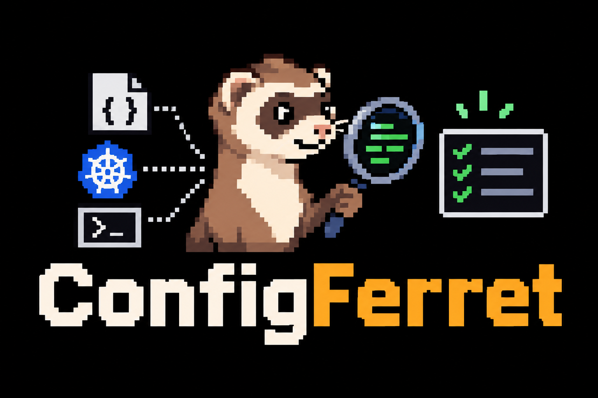

<p align="center">
  
</p>

# ConfigFerret

**Why is this value 42?** ConfigFerret traces every effective .NET configuration value back through all the
layers that set it: appsettings files, environment variables, the command line, Kubernetes ConfigMaps and
Secrets, Helm values files, Kustomize overlays, Argo CD and Flux releases, and Terraform outputs.

```
Db:Timeout = "42"
  set in appsettings.json, overridden by appsettings.Production.json, overridden again by environment variable DB__Timeout from ConfigMap api-config, rendered by Helm template templates/configmap.yaml from .Values.db.timeout, set in values-prod.yaml over values.yaml (chart default)
  [overridden] appsettings.json (line 4) = "30"
  [overridden] appsettings.Production.json (line 3) = "60"
  [effective]  environment variable DB__Timeout = "42"
    <- [effective]  ConfigMap api-config (key DB__Timeout, rendered.yaml:7) = "42"
                    envFrom on Deployment/api, container api
      <- [effective]  Helm template templates/configmap.yaml (line 6) = "42" [inferred]
                      renders .Values.db.timeout
        <- [overridden] values.yaml (chart default) (line 3, db.timeout) = "30"
        <- [effective]  values-prod.yaml (line 2, db.timeout) = "42"
```

Each layer has its own partial debug view (`GetDebugView()`, `helm get values`, `kubectl describe`).
ConfigFerret joins them into one history per key.

## Install

```
dotnet package add ConfigFerret
```

Targets `net10.0` and `net11.0`.

Optional packages read variables and secrets from deployment tools, stores and live clusters over their APIs. They are separate so the core
package stays offline and never handles credentials unless you add one:

| Package | Adds |
| --- | --- |
| `ConfigFerret.GitHub` | GitHub Actions organization, repository and environment variables, and secret names ([readme](src/ConfigFerret.GitHub/README.md)) |
| `ConfigFerret.Octopus` | Octopus Deploy project and library variable set variables, matched by scope, read with an API key ([readme](src/ConfigFerret.Octopus/README.md)) |
| `ConfigFerret.HashiCorp` | HashiCorp Vault KV secrets (names and metadata, values only when asked) and Consul KV keys, read with a token ([readme](src/ConfigFerret.HashiCorp/README.md)) |
| `ConfigFerret.KubernetesCluster` | A workload, its ConfigMaps, opt-in Secrets, ExternalSecrets and SecretProviderClasses, read from a live cluster through a kubeconfig or the pod's service account ([readme](src/ConfigFerret.KubernetesCluster/README.md)) |
| `ConfigFerret.Azure` | Azure Key Vault secrets (names and properties, values only when asked) and Azure App Configuration key-values, Key Vault references and feature flags, read with the Azure SDK ([readme](src/ConfigFerret.Azure/README.md)) |
| `ConfigFerret.Aws` | AWS Secrets Manager secrets (and JSON secret properties) and Systems Manager Parameter Store parameters, read with the AWS SDK ([readme](src/ConfigFerret.Aws/README.md)) |
| `ConfigFerret.GoogleCloud` | Google Cloud Secret Manager secrets (names, labels and version states; values only when asked), read with Application Default Credentials ([readme](src/ConfigFerret.GoogleCloud/README.md)) |
| `ConfigFerret.AzureDevOps` | Azure Pipelines variable groups (secret names, Key Vault-linked groups) and pipeline YAML variables, read with a personal access token ([readme](src/ConfigFerret.AzureDevOps/README.md)) |
| `ConfigFerret.GitLab` | GitLab project, group and instance CI/CD variables with the environment scope that applies, and `.gitlab-ci.yml` variables ([readme](src/ConfigFerret.GitLab/README.md)) |

To trace from the command line without writing code, install the `configferret` command instead:

```
dotnet tool install -g ConfigFerret.Tool
```

### Desktop app

There is also a desktop app that scans a GitHub repository or a local folder and shows where each configuration value
comes from. Download it from [GitHub Releases](https://github.com/Moonwalker1307/ConfigFerret/releases) (the
`desktop-v*` tags), not from NuGet. See [its readme](src/ConfigFerret.Desktop/README.md).

### Web app in Docker

The same app also runs as a website in a container, released as an image on GitHub (`ghcr.io`, the `web-v*` tags),
not on NuGet:

```
docker run --rm -p 127.0.0.1:8080:8080 ghcr.io/moonwalker1307/configferret-web
```

Then open http://localhost:8080. See [its readme](src/ConfigFerret.Web/README.md).

## Use

### From the command line

`configferret` builds the app's configuration from its folder the way the .NET host does (`appsettings.json`,
`appsettings.{Environment}.json`, user secrets in Development, environment variables, the command line) and traces it
through the manifests, chart or overlay it is deployed with. Nothing is read from your shell's environment, and secret
values are shown as `***` unless you pass `--reveal-secrets`.

```
helm template orders charts/orders -f values-prod.yaml > rendered.yaml
configferret trace Db:Timeout --app src/Orders.Api -m rendered.yaml -w orders --chart charts/orders -f values-prod.yaml

configferret unused --app src/Orders.Api -m rendered.yaml --reads reads.txt --exit-code
configferret container -m pod.yaml -c api --chart charts/api -f release-values.yaml --format json
```

`trace` explains the keys you name, or every key. `unused` lists values that never win and, with `--reads`, keys the
app never read. `container` traces one container from outside the app. The container's environment variables come
from `-m`, and `--env`, `--env-file` and `--env-prefix` add to or shape them. GitHub and Octopus variables are read with
`--github-repo` and `--octopus-project`, with the token in `GITHUB_TOKEN` and the API key in `OCTOPUS_API_KEY`, never in
an option. See the [tool's readme](src/ConfigFerret.Tool/README.md) for every command, option and exit code.

### Just .NET configuration

```csharp
using ConfigFerret;

var builder = WebApplication.CreateBuilder(args);
Console.WriteLine(builder.Configuration.Explain("Db:Timeout"));

// Or every setting, as text or JSON:
var report = builder.Configuration.TraceProvenance();
Console.WriteLine(report.ToText());
File.WriteAllText("config-provenance.json", report.ToJson());
```

### With Kubernetes, Helm and Kustomize

```csharp
using ConfigFerret;
using ConfigFerret.Helm;
using ConfigFerret.Kubernetes;
using ConfigFerret.Kustomize;

var report = ConfigTracer.For(builder.Configuration)
    // Rendered manifests: `helm template`, `kustomize build` or `kubectl get deploy/api -o yaml` plus its ConfigMaps.
    .WithKubernetes(KubernetesManifests.LoadFiles("rendered.yaml"), workload: "api", container: "api")
    // The chart and the values passed to helm install/upgrade, in the same order.
    .WithHelm(HelmChart.Load("charts/api", valuesFiles: ["values-prod.yaml"], setValues: ["db.timeout=42"]))
    // Or the overlay you deploy with kustomize.
    .WithKustomize(Kustomization.Load("deploy/overlays/prod"))
    .Trace();

Console.WriteLine(report.Explain("Db:Timeout"));
```

### With Argo CD, Flux or Terraform

These are in the core package and read only local files: the manifests in your Git checkout and the output of
`terraform output -json`.

```csharp
using ConfigFerret;
using ConfigFerret.GitOps;
using ConfigFerret.Kubernetes;
using ConfigFerret.Terraform;

// An Argo CD Application or a Flux HelmRelease becomes the Helm layers it deploys: the chart's values.yaml, its
// values files, then the values and parameters written in the manifest, merged the way Argo CD or Flux merges them.
var app = GitOpsApplication.Load("deploy/apps/orders-prod.yaml");
var report = ConfigTracer.ForContainer(KubernetesManifests.LoadFile("rendered.yaml"), workload: "orders")
    .WithGitOps(app, new GitOpsOptions
    {
        RepositoryRoot = "deploy",          // the local checkout: chart paths, values files, $ref/ files
        ChartFolder = "charts/orders",      // only for a chart from a Helm or OCI repository (helm pull --untar)
    })
    // `terraform output -json > outputs.json`; the folder's .tf files say where each output is defined.
    .WithTerraform(TerraformOutputs.Load(outputsFile: "outputs.json", terraformFolder: "infra"),
        o => o.Map("ORDERS_DB_HOST", "db.host"))
    .Trace();
```

`HelmChart.ForGitOps(app, options)` gives the same chart without the rest, for `WithHelm`. Inline values and
parameters show as layers named after the object, for example `Argo CD Application orders-prod (helm.values)`, in
Argo CD's order (`valueFiles`, then `values` or `valuesObject`, then `parameters`) or Flux's (chart `valuesFiles`,
then each `valuesFrom` ConfigMap or Secret, then `spec.values`). Values from a Secret are sensitive. A chart from a
remote repository cannot be fetched, so the trace warns and still shows the values the manifest sets.

`WithGitOps` also links ConfigMap keys to inline Argo CD kustomize patches that set them, and, for a Flux
Kustomization with `postBuild`, links each value to the `${VAR}` placeholder in the manifests under `spec.path` and
to the `substitute` or `substituteFrom` entry that fills it. Pass the ConfigMaps and Secrets that `valuesFrom` and
`substituteFrom` read in `GitOpsOptions.Data` when they are not in the same file.

Terraform outputs link to environment variables and ConfigMap or Secret keys by name (`db_timeout` matches
`DB_TIMEOUT`, `Db__Timeout` and `db.timeout`), marked `[inferred]`, or by explicit link. Object and list outputs are
split into `name.path` values. From a state file (`TerraformOutputs.Load(stateFile: "terraform.tfstate")`) only the
outputs are read, never resource attributes. Sensitive outputs are redacted like any other secret.

The same sources are `IConfigSource`s, with the providers `argocd-application`, `flux-helmrelease`,
`flux-kustomization` and `terraform-outputs` (see [Plugging in another source](#plugging-in-another-source)).

### With GitHub Actions or Octopus Deploy variables

```csharp
using ConfigFerret;
using ConfigFerret.GitHub;   // dotnet package add ConfigFerret.GitHub
using ConfigFerret.Octopus;  // dotnet package add ConfigFerret.Octopus

var github = await GitHubVariables.LoadAsync(new GitHubVariablesOptions
{
    Owner = "contoso", Repository = "api", Environment = "production",
    Token = Environment.GetEnvironmentVariable("GITHUB_TOKEN"),
});
var octopus = await OctopusVariables.LoadAsync(new OctopusVariablesOptions
{
    ServerUri = new Uri("https://contoso.octopus.app/"),
    ApiKey = Environment.GetEnvironmentVariable("OCTOPUS_API_KEY")!,
    Project = "api",
});

var report = ConfigTracer.For(builder.Configuration)
    .WithGitHub(github, o => o.AddWorkflow(".github/workflows/deploy.yml"))
    .WithOctopus(octopus, o => o.Environment = "Production")
    .Trace();
```

Both packages can also be set up from configuration with dependency injection:

```csharp
builder.Services.AddConfigFerretGitHub(builder.Configuration.GetSection("ConfigFerret:GitHub"));
builder.Services.AddConfigFerretOctopus(builder.Configuration.GetSection("ConfigFerret:Octopus"));
var app = builder.Build();

var tracer = ConfigTracer.For(builder.Configuration);
await tracer.WithGitHubAsync(app.Services);
await tracer.WithOctopusAsync(app.Services);
var report = tracer.Trace();
```

Put the owner, repository, server address, project and environment in appsettings.json. Put the token and API key in
user secrets (`dotnet user-secrets set "ConfigFerret:Octopus:ApiKey" "API-..."`), an environment variable
(`ConfigFerret__Octopus__ApiKey`) or a key vault, never in a committed appsettings file: startup fails if either is in
an `appsettings*.json` file. See each package's readme for the settings.

Tokens and API keys go only in request headers, only over HTTPS, and never into a report. Secret values cannot be read
from either API, so secrets and sensitive variables appear by name and are redacted like any other secret.

### With HashiCorp Vault or Consul

```csharp
using ConfigFerret.HashiCorp;   // dotnet package add ConfigFerret.HashiCorp

var vault = await VaultSecrets.LoadAsync(new VaultOptions
{
    Address = new Uri("https://vault.example.com:8200/"),
    Token = Environment.GetEnvironmentVariable("VAULT_TOKEN"),
    Paths = { "orders/prod" },
});
var consul = await ConsulKeyValues.LoadAsync(new ConsulOptions
{
    Address = new Uri("https://consul.example.com:8501/"),
    Token = Environment.GetEnvironmentVariable("CONSUL_HTTP_TOKEN"),
    Prefix = "config/orders/",
});

var report = ConfigTracer.For(builder.Configuration)
    .WithVault(vault)
    .WithConsul(consul)
    .Trace();
```

Vault secrets are linked from External Secrets Operator and Secrets Store CSI references, explicit links, and layers
whose name gives the same configuration key. Only names and metadata are read unless you set `IncludeValues`, and
every Vault step is sensitive. Consul keys under the prefix map to configuration keys the way
Winton.Extensions.Configuration.Consul maps them (`config/orders/Db/Timeout` sets `Db:Timeout`). Both register with
`AddConfigFerretVault` and `AddConfigFerretConsul`, like the packages above.

### With a live Kubernetes cluster

```csharp
using ConfigFerret.KubernetesCluster;  // dotnet package add ConfigFerret.KubernetesCluster

// Uses KUBECONFIG or ~/.kube/config, with its token, client certificate or exec plugin.
var cluster = await KubernetesClusterReader.LoadAsync(new KubernetesClusterOptions
{
    Context = "prod", Namespace = "orders", Workload = "deployment/orders-api",
});
var report = ConfigTracer.For(builder.Configuration).WithKubernetesCluster(cluster).Trace();
```

Secrets are read only with `IncludeSecrets = true`; otherwise a `secretKeyRef` shows as a secret with an unknown
value. Register it from configuration with `AddConfigFerretKubernetesCluster(section)` and
`await tracer.WithKubernetesClusterAsync(app.Services)`.

### With Azure Key Vault or App Configuration

```csharp
using ConfigFerret.Azure;   // dotnet package add ConfigFerret.Azure

// Signs in with DefaultAzureCredential (managed identity, workload identity, Azure CLI and so on).
var vault = await AzureKeyVaultSecrets.LoadAsync(new AzureKeyVaultOptions { VaultUri = new("https://contoso-prod.vault.azure.net/") });
var store = await AzureAppConfigurationSettings.LoadAsync(new AzureAppConfigurationOptions
{
    Endpoint = new("https://contoso.azconfig.io"),
    Labels = { "base", "production" },   // in the app's Select order: the last label wins
});

var report = ConfigTracer.For(builder.Configuration)
    .WithAzureAppConfiguration(store)
    .WithAzureKeyVault(vault)
    .Trace();
```

Key Vault secrets are linked to environment variables, Kubernetes env entries and Secret keys by name (`Db__Password`
and `Db--Password` both set `Db:Password`), to External Secrets references, to App Configuration Key Vault references,
and to values from the Key Vault configuration provider. Only names and properties are read unless `IncludeValues` is
on, and every secret is redacted. `AddConfigFerretAzureKeyVault` and `AddConfigFerretAzureAppConfiguration` set both up
from configuration; startup fails if a client secret or connection string is in an appsettings file.

### With AWS Secrets Manager or Parameter Store

```csharp
using ConfigFerret.Aws;   // dotnet package add ConfigFerret.Aws

// The default AWS credential chain signs in; set Profile or Credentials to pick another identity.
var secrets = await AwsSecrets.LoadAsync(new AwsSecretsManagerOptions { Region = "eu-west-1", NamePrefix = "prod/orders/" });
var parameters = await AwsParameters.LoadAsync(new AwsParameterStoreOptions { Region = "eu-west-1", Path = "/orders/prod/" });

var report = ConfigTracer.For(builder.Configuration)
    .WithAwsSecretsManager(secrets)
    .WithAwsParameterStore(parameters)
    .Trace();
```

External Secrets Operator references link to the secret, JSON property or parameter they name. Environment variables
and keys from `AddSecretsManager` or `AddSystemsManager` link by name, with the prefix or path removed and `/` mapped
to `:`. Only names and metadata are read unless `IncludeValues` is on; secret and `SecureString` values are always
redacted. `AddConfigFerretAwsSecretsManager` and `AddConfigFerretAwsParameterStore` register both from configuration;
startup fails if an access key is in an `appsettings*.json` file.

### With Google Cloud Secret Manager

```csharp
using ConfigFerret.GoogleCloud;  // dotnet package add ConfigFerret.GoogleCloud

// Signs in with Application Default Credentials unless you pass an access token, a credential or a service account key.
var gcp = await GcpSecrets.LoadAsync(new GcpSecretManagerOptions { ProjectId = "contoso-prod", IncludeVersions = true });

var report = ConfigTracer.For(builder.Configuration)
    .WithGcpSecretManager(gcp)
    .Trace();
```

Secrets are linked from External Secrets Operator `gcpsm` references and Secrets Store CSI `resourceName` values for
certain, and from environment variables and keys with the same name (`Db__Timeout` for `Db:Timeout`) as inferred
links. Only names and metadata are read unless you turn on `IncludeValues`, and every value is marked sensitive. From
configuration, use `builder.Services.AddConfigFerretGcpSecretManager(builder.Configuration.GetSection("ConfigFerret:GcpSecretManager"))`
and `await tracer.WithGcpSecretManagerAsync(app.Services)`.

### With Azure DevOps or GitLab CI/CD variables

```csharp
using ConfigFerret.AzureDevOps;  // dotnet package add ConfigFerret.AzureDevOps
using ConfigFerret.GitLab;       // dotnet package add ConfigFerret.GitLab

var groups = await AzureDevOpsVariableGroups.LoadAsync(new AzureDevOpsOptions
{
    OrganizationUrl = new Uri("https://dev.azure.com/contoso/"), Project = "api",
    GroupNames = { "api-production" },
    PersonalAccessToken = Environment.GetEnvironmentVariable("AZURE_DEVOPS_EXT_PAT"),
});
var gitlab = await GitLabVariables.LoadAsync(new GitLabOptions
{
    Project = "contoso/platform/api",
    Token = Environment.GetEnvironmentVariable("GITLAB_TOKEN"),
});

var report = ConfigTracer.For(builder.Configuration)
    .WithAzureDevOps(groups, o => o.AddPipeline("azure-pipelines.yml"))
    .WithGitLab(gitlab, o => { o.Environment = "production"; o.AddCiFile(".gitlab-ci.yml"); })
    .Trace();
```

Azure DevOps variables match by their exact name or the name scripts see (`Db.Timeout` as `DB_TIMEOUT`), and by
`NAME: $(Var)` lines in pipeline YAML. GitLab variables match by key and by `NAME: $VAR` or `export NAME=$VAR` lines,
and each step uses the environment scope that fits `Environment`, ordered instance, groups, project. Both register with
`AddConfigFerretAzureDevOps(...)` or `AddConfigFerretGitLab(...)` and load with `WithAzureDevOpsAsync` or
`WithGitLabAsync`, with the same startup checks as above. Secret, masked and hidden variables appear by name and are
redacted. Variables named like secrets (`Smtp.Password`, `SMTP_PASSWORD`) and GitLab file variables are redacted too.

### Inside a running pod

```csharp
if (KubernetesInCluster.IsInCluster)
{
    var pod = await KubernetesInCluster.LoadCurrentPodAsync();
    var report = ConfigTracer.For(builder.Configuration).WithKubernetes(pod).Trace();
}
```

This reads the pod (`POD_NAME` or `HOSTNAME`) and the ConfigMaps it references with the pod's service account.
Grant it `get` on `pods` and `configmaps` in its namespace. Secrets are never read through the API.

### From outside the app: a container in the cluster

A tool that only sees the cluster, such as a cluster browser, has the manifests but not the app's own
configuration. `ForContainer` traces what one container gets: every environment variable, then every file a
ConfigMap or Secret volume mounts, each followed back to the ConfigMap, Secret or env entry and from there to Helm
or Kustomize.

```csharp
using ConfigFerret;
using ConfigFerret.Helm;
using ConfigFerret.Kubernetes;

var manifests = KubernetesManifests.Parse(podYaml, "pod api-7d9f");
manifests.Add(configMapYaml, "configmap api-config");   // each ConfigMap and Secret the pod uses

// What the Helm release holds: the chart's values, the release's own values and the templates.
var chart = HelmChart.FromText(
    [("values.yaml (chart default)", chartValuesYaml), ("release values", releaseValuesYaml)],
    chartTemplates);                                     // (path, text) pairs

var report = ConfigTracer.ForContainer(manifests, workload: "api-7d9f", container: "api")
    .WithHelm(chart)
    .Trace();

Console.WriteLine(report.Explain("DB__Timeout"));
Console.WriteLine(report.Explain("/app/appsettings.Production.json"));
```

- Keys are the environment variable names, matched case-sensitively, and the files' absolute paths. A file's value
  is its full content; text output shortens it to one line.
- A variable that Kubernetes sets at run time (`fieldRef`) shows `(set at run time)`. One whose ConfigMap or Secret
  is not in the manifests shows `(unknown)`, and its value is `null` in JSON. An `envFrom` source or a volume without
  `items` that is not in the manifests gives a warning, since the names it adds can't be listed.
- Helm stores only the merged values a release was installed with, so a trace built from a release shows one
  "release values" layer rather than the separate `-f` files and `--set` flags.
- Nothing is read from the caller's own process environment, so the tool's own variables never reach the report.
  Leave Secrets out of the manifests if the tool shouldn't read them: a `secretKeyRef` to one then shows `(unknown)`.
- `WithKubernetes` throws on a container trace, since the manifests are already passed to `ForContainer`.

### With Docker Compose and dotenv files

`ComposeProject` reads compose files the way `docker compose config` does: it merges `compose.yaml` with
`compose.override.yaml` (or each `-f` file), follows `extends` and `include`, and fills in `${VAR}` from the project's
`.env` (or `--env-file`). `ForCompose` traces what one service's containers get, and `WithCompose` links an app's
environment variables to the service it runs as.

```csharp
using ConfigFerret;
using ConfigFerret.Compose;

var options = new ComposeOptions();            // the process environment is not read unless you set UseProcessEnvironment
options.Variables["TAG"] = "1.4.2";            // stands for the shell; it wins over .env
var project = ComposeProject.Load(["compose.yaml", "compose.override.yaml"], options);

// From outside the app: every variable and every mounted secret or config of the api service.
var report = ConfigTracer.ForCompose(project, "api").Trace();
Console.WriteLine(report.Explain("Db__Host"));

// Inside the app: link its environment variables to the compose layers.
var appReport = ConfigTracer.For(builder.Configuration).WithCompose(project, "api").Trace();
```

Each variable lists its `env_file` lines, then its `environment` entries (a later compose file's entry wins). Each
`${VAR}` in them points to the `.env` line or shell variable it came from. Values whose names look secret, values that
take a variable named like a secret through any number of `${VAR}` references, and every compose `secret`, are
redacted. File-based secrets are listed at `/run/secrets/<name>` without reading them unless `ReadSecretFiles` is set.

`DotEnvFile.Parse(text, name)` and `DotEnvFile.Load(path)` parse one dotenv file with compose's rules (`export`,
single, double and backtick quotes, multi-line values, `\n` escapes, `#` comments, `${VAR:-default}`), keeping the
line of every key. `DotEnvLayers.Load([".env", ".env.local", ".env.production"])` layers several, the later one
winning, and `tracer.WithDotEnv(layers)` links environment variables to their lines. As sources, the `dotenv` and
`docker-compose` providers (`DotEnvSourceProvider`, `ComposeSourceProvider`) plug both into hosts such as the
desktop app.

### Find possibly unused configuration

```csharp
var builder = WebApplication.CreateBuilder(args);
// After the last configuration source is added:
var reads = builder.Configuration.RecordReads();

// ... later, once the app has run through the code paths you care about:
var unused = builder.Configuration.TraceProvenance().FindUnused(reads);
Console.WriteLine(unused.ToText());
```

`FindUnused` reports two things:

- **Values that never win.** An appsettings key, env entry, ConfigMap key, Helm value or Kustomize literal that a
  later layer always overrides or removes in this trace, with the layer that beats it. Overrides that set the same
  value as the winner are called out, since they change nothing here. This needs no recorder: call `FindUnused()`.
- **Keys the app did not read.** Configured keys that `RecordReads()` never saw the app read, with every layer
  that sets them, so you can see where each one lives. Reads through `configuration["X"]`, `GetValue`, `GetSection`
  and options binding are all recorded, since the recorder sits under every provider. Plain process environment
  variables such as `PATH` are left out.

```
Values that never win (2)
  Db:Port
    appsettings.json (line 4) = "5432"
      overridden by environment variable ORDERS_Db__Port
      sets the same value as the layer that wins, so it changes nothing here
  Db:Timeout
    values.yaml (chart default) (line 8, db.timeout) = "30"
      overridden by values-eu.yaml (line 2, db.timeout)
      upstream of environment variable ORDERS_Db__Timeout <- ConfigMap orders-config <- Helm template templates/configmap.yaml

Keys the app did not read (1, from 9 recorded reads)
  Pod:Name = "orders-7c9d8f6b5-x2kqp"
    set in environment variable ORDERS_Pod__Name from downward API metadata.name
    ...
```

Everything it finds is **possibly** unused, never proven safe to delete. A value that never wins in production can
still be the default in development, and a key can be read on a code path that did not run while reads were
recorded. To cover more paths, save `reads.ReadKeys` from several runs or instances and pass them all to
`FindUnused(IEnumerable<string>)`. Code that walks every key, such as `AsEnumerable()` or `GetDebugView()`, marks
every key as read. ConfigFerret's own tracing is not recorded.

### Plugging in another source

The AWS, Azure, Azure DevOps, Google Cloud, GitLab, HashiCorp and Kubernetes cluster packages implement
`ConfigFerret.Sources.IConfigSource` (read the store once and return a `LoadedConfigSource`), and describe their settings
with an `IConfigSourceProvider`, so the desktop app, the tool and your own code can list, configure and load each of these
sources the same way. The GitHub and Octopus packages implement neither interface; use `WithGitHub` and `WithOctopus`
for them.

```csharp
using ConfigFerret.Sources;

var tracer = ConfigTracer.For(builder.Configuration);
var loaded = await tracer.WithSourceAsync(source);   // any IConfigSource
var report = tracer.Trace();
foreach (var entry in loaded.FindUnused(report))     // secrets or variables nothing links to
{
    Console.WriteLine($"{loaded.DisplayName}: {entry.Name} looks unused");
}
```

An `IConfigSourceProvider` lists its settings (`SourceSetting`: name, label, kind, required, help). Settings of kind
`Secret` are credentials: hosts keep them in a credential store or read them from an environment variable, and never
save them with a profile. `LayerNames.Of(step)` and `LayerNames.ToConfigurationKey(name, separator)` help a resolver
match environment variables, Kubernetes env entries and ConfigMap or Secret keys to entries in a store.

## What it traces

| Layer | What ConfigFerret shows |
| --- | --- |
| JSON files (`appsettings*.json`) | File and line number |
| User secrets | Marked sensitive |
| Environment variables | The exact variable name, including prefixes and `__`, and `*CONNSTR_` connection strings |
| Command line | The argument |
| Key-per-file (mounted secrets) | The file, marked sensitive |
| Kubernetes `env` | Literal value, `configMapKeyRef`, `secretKeyRef`, `fieldRef`, with workload and container |
| Kubernetes `envFrom` | Which ConfigMap or Secret, with prefix, and the precedence between `envFrom` and `env` |
| Kubernetes volumes | Which ConfigMap or Secret key a mounted file comes from (`configMap`, `secret`, `projected`, `subPath`, `items`) |
| External Secrets Operator | The `ExternalSecret` behind a Secret key (`spec.data` remote key, property and version, the `SecretStore` or `ClusterSecretStore` and its provider). Its target Secret counts as existing with unknown values when it is not in the manifests; `dataFrom` keys show as a guess |
| Secrets Store CSI driver | The `SecretProviderClass` object behind a mounted CSI file or a key of a Secret it syncs (`secretObjects`), for the `azure`, `aws`, `gcp` and `vault` providers |
| Helm | The template line that renders the key, and every values file and `--set` that set or removed the value |
| Kustomize | Every `configMapGenerator` and `secretGenerator` across bases, overlays and components (`create`, `merge`, `replace`, `literals`, `envs`, `files`, `namePrefix`, `nameSuffix`, hash suffixes) |
| Argo CD | An Application's or ApplicationSet template's Helm `valueFiles` (also `$ref/` files), `values`, `valuesObject` and `parameters` (with `forceString`), and ConfigMap data set by inline kustomize patches; other kustomize settings (`images`, `namePrefix`, `commonLabels`) become warnings |
| Flux | A HelmRelease's chart `valuesFiles`, `valuesFrom` ConfigMaps and Secrets (`valuesKey`, `targetPath`, `optional`) and `spec.values`; a Kustomization's `postBuild` `substitute` and `substituteFrom` behind `${VAR}` placeholders |
| Terraform | The output (or the value nested in an object or list output) with the same or a linked name, and the `.tf` file and line that defines it |
| dotenv files | File and line of each key, across layered files, and the line or variable behind every `${VAR}` |
| Docker Compose | Each `env_file` line and `environment` entry across compose files, `extends` and `include`, the `.env` line or shell variable behind each `${VAR}`, and mounted `secrets` and `configs` |
| GitHub Actions (`ConfigFerret.GitHub`) | The organization, repository or environment variable or secret, from a workflow `env:` line, an explicit link or the same name |
| Octopus Deploy (`ConfigFerret.Octopus`) | The project or library variable set variable whose scope fits the deployment, ordered by scope specificity |
| HashiCorp Vault (`ConfigFerret.HashiCorp`) | The KV secret (and key, when values are read) behind an External Secrets or CSI reference, an explicit link or the same name, with version and update time |
| Consul KV (`ConfigFerret.HashiCorp`) | The key under the prefix that sets the configuration key, including keys inside expanded JSON values |
| Live cluster (`ConfigFerret.KubernetesCluster`) | The same Kubernetes layers, read from the API server for one workload instead of from manifest files |
| AWS (`ConfigFerret.Aws`) | The Secrets Manager secret or JSON property, or the Parameter Store parameter, from an External Secrets reference, an explicit link, the same name or the AWS configuration providers' key mapping |
| Google Cloud Secret Manager (`ConfigFerret.GoogleCloud`) | The secret, from an External Secrets Operator or CSI reference, an explicit link or the same name, with its version state |
| Azure DevOps (`ConfigFerret.AzureDevOps`) | The variable group variable or pipeline YAML variable, from an `env:` line, an explicit link, the same name or the name scripts see, in the pipeline's group order |
| GitLab CI/CD (`ConfigFerret.GitLab`) | The project, group or instance variable whose environment scope applies, or the `.gitlab-ci.yml` variable, in GitLab's precedence |

Workloads: Deployment, StatefulSet, DaemonSet, ReplicaSet, Job, CronJob, Pod and `List` documents.

## Secrets

Values are redacted as `***` when they come from a Secret, user secrets, key-per-file or a `*CONNSTR_` environment
variable, when the key looks secret, or when the setting's trace was cut off (see [Limits](#limits)). Every value set
by the Azure Key Vault configuration provider (`Azure.Extensions.AspNetCore.Configuration.Secrets`, or the older
`Microsoft.Extensions.Configuration.AzureKeyVault`), Kralizek's AWS Secrets Manager provider or the VaultSharp Vault
provider is redacted too, with or without the extension package. A key looks secret when:

- it contains, in any letter case, `password`, `passwd`, `pwd`, `passphrase`, `secret`, `token`, `credential`,
  `bearer`, `apikey`, `connectionstring`, `connstr`, `privatekey`, `accesskey` or `sharedaccess`, also with `_` or `-`
  between the words (`OPENAI_API_KEY`, `DB_CONNECTION_STRING`, `shared-access-signature`), or `key` right after
  `signing`, `encryption`, `master`, `shared`, `account`, `storage`, `hmac` or `subscription` (`Jwt:SigningKey`);
- `pass`, `key`, `sas` or `dsn`, in any letter case, has no letter right before or after it (`Db:Pass`, `Jwt:Key`,
  `DB_PASS`, `sentry-dsn`);
- `Key`, `Pass`, `Sas` or `Dsn`, written just so, has no letter right after it, so it ends a PascalCase or camelCase
  word (`JwtKey`, `Cosmos__AuthKey`, `smtpPass`, `SentryDsn`), except in `PartitionKey`, `RoutingKey` and `PublicKey`;
- `SasUrl` or `SasUri` ends a word (`Storage:SasUrl`, `blobSasUri`, `sasUrl`), since a SAS URL holds the signature.

So `Cache:KeyPrefix`, `KeyVaultName`, `PrimaryKeyColumn`, `PassThrough`, `Bypass` and `SasUrlExpiryDays` stay
visible. The same rule applies to the name of each upstream value, such as a ConfigMap key, an env entry, a Helm
values path or a GitHub or Octopus variable: env `Smtp__Auth` from ConfigMap key `smtp-password` is `***`, and so is
everything upstream of that key. Only the value's own name counts, not the ConfigMap, workload, file or folder that
holds it, a prefix in front of the key, or the folders of an AWS parameter or a Consul key. A settings file mounted
from a ConfigMap key that looks secret, such as `appsettings.Secrets.json`, has all its values hidden.

Turn redaction off only on your own machine:

```csharp
ConfigTracer.For(config).WithOptions(o => o.RevealSensitiveValues = true);
```

## Limits

- Helm links are found by scanning templates for `.Values.x.y` on lines that set an env `value:` or a data key,
  so they are marked `[inferred]`. Values used through `with`, `range`, `include` or helpers are not linked yet. A
  line that mixes `.Values.x` with `include`, `tpl` or a helper is linked to `x` only, so what the helper adds is not
  seen, and the value is hidden only when `x` or a value below it comes from a Secret. Subchart values are not traced
  yet.
- Helm links match env entries and data keys by name, so an env entry that overrides a templated ConfigMap key of
  the same name is linked to that ConfigMap's template too. The note then says the values and the manifest disagree.
- `Kustomization.Load` throws when bases and components nest more than 100 deep, when it would read more than 10,000
  kustomizations, when one kustomization or env file holds more than 16 MiB of text, or when all it reads from
  kustomization and env files holds more than 256 MiB. A base, component or env file counts again each time something
  names it.
- Kustomize patches that edit env entries or ConfigMap data are not traced yet.
- Like kustomize, a generator's `envs` files must be in or below the folder of the kustomization that names them.
  Pass `allowFilesOutsideFolder: true` to `Kustomization.Load` to lift this, like `--load-restrictor LoadRestrictionsNone`.
- A folder of manifests, a chart's `templates` folder and the folder a GitOps app deploys are read without following
  symbolic links: a linked file or folder below them is skipped.
- GitHub and Octopus links by name or JSON key are guesses, so they are marked `[inferred]`; a workflow `env:` line or
  `Map` makes a certain link. When a name is on both an environment variable and the Kubernetes env entry behind it,
  the GitHub or Octopus layer shows under both. Octopus `#{...}` references are not expanded.
- External Secrets Operator and Secrets Store CSI values are never in the manifests, so those Secret keys and files
  show `(unknown)`. The secret store packages link the `ExternalSecretRef` step to the secret in the store.
  `spec.target.template`, `dataFrom.find`, generators and `ClusterExternalSecret` are not expanded.
- Argo CD and Flux charts from a Helm or OCI repository are not fetched; pass the pulled chart folder. Remote values
  files (`https://`) and `fileParameters` are not read. Argo CD `$ref/` values files are looked up in the one
  repository checkout you pass. ApplicationSet generator parameters (`{{cluster}}`) are not filled in. A source path
  or Flux `spec.path` that leads outside the checkout (with `..` or a symbolic link) is not read, and neither is a
  chart's `values.yaml` or `templates` folder that links outside it; the trace warns instead. A values file is read
  when it is in the checkout or the chart folder, also when it is named with `..` from the chart folder. Unlike Argo
  CD, a values file that starts with `/` is looked up in the chart folder before the checkout root, and a name that is
  missing from the chart folder is read from the checkout root, where Argo CD fails the sync.
- Argo CD kustomize patches are traced only when they are inline and set ConfigMap `data` (strategic merge, or JSON
  patch on `/data/...`). Patch files, env patches, Flux `spec.patches` and `postRenderers` are not traced.
- A Flux `${VAR}` link needs the source manifests under `spec.path` in the checkout, and matches the rendered
  ConfigMap, Secret or workload by the name in Git, so a kustomize `namePrefix` there breaks it. A value with several
  placeholders links to the source line only, and is redacted when a loaded Secret fills one of them; when the
  `substituteFrom` Secret was not loaded, nothing says it holds a secret and the value is shown. The
  `kustomize.toolkit.fluxcd.io/substitute: disabled` annotation is not read. `${VAR}` inside a HelmRelease's values
  is not linked.
- Terraform links by name are guesses, so they are marked `[inferred]`. Only state format version 4 is read, and only
  its outputs. A `.tf` output block is found only when `output "name" {` starts a line.
- YAML whose aliases expand to more than 10 million characters is rejected, and so is YAML whose collections nest
  more than 256 levels deep (an alias counts as the collection it stands for).
- Docker Compose: a missing required `env_file`, `extends` file or `include` is a warning rather than an error, so
  the rest can still be traced. Only `secrets`, `configs`, `env_file` and `environment` are read; profiles, `build`
  args and labels are not. A path or name in a compose file that takes its value from a variable named like a secret,
  directly or through other `${VAR}` references, is rejected, since paths and names are never redacted.
- Docker Compose: a file that a compose file names (a config's or secret's `file`, an `env_file`, an `extends` file,
  an `include` and its env files) and the project's `.env` are read only from in or below the project directory,
  after following symbolic links (a link to another drive, share or device counts as outside, unless the project
  directory really lies there); an include's `project_directory` does not widen this. Others are not read and are
  listed in the warnings. Set `ComposeOptions.AllowFilesOutsideProject` (`--compose-allow-files-outside-project`) to
  read them from anywhere, as docker compose does. Either way a folder is not read, and a file of size 0, as a FIFO
  or a device reports, is taken as empty without opening it. The compose files, env files and project directory you
  pass are read as they are.
- A trace follows each .NET configuration layer at most `MaxDepth` levels upstream (default 8). It also stops asking
  resolvers once they have added 1,000 upstream steps to one setting or 250,000 to the whole trace, so a resolver
  that links each step to several others cannot make a trace grow without end. A setting cut off this way, or with a
  chain that goes on beyond `MaxDepth`, gets a warning, and its values are hidden as `***` unless
  `RevealSensitiveValues` is on, since the part not traced may hold a secret. Once the trace-wide limit is reached,
  every setting after it is cut off. A `MaxDepth` of 0 follows nothing upstream and hides nothing for it.
- Dotenv and compose `${VAR}` references are followed 8 deep. At most 1,000 steps are built under one value (under
  all the lines that set one variable, for `WithDotEnv`), and 250,000 for one load of a compose project, included
  projects and all. The step whose references were not all followed says so in its note, and its value is still
  hidden when a reference not followed leads to a variable named like a secret.
- Unread keys come from recorded reads only; the code is not scanned for keys it could read.
- Custom configuration providers show their `ToString()`. Add an `IOriginResolver` with `WithResolver` to trace
  further upstream from them.

## Build

```
dotnet build
dotnet test
dotnet pack src/ConfigFerret -c Release
dotnet pack src/ConfigFerret.GitHub -c Release
dotnet pack src/ConfigFerret.Octopus -c Release
dotnet pack src/ConfigFerret.HashiCorp -c Release
dotnet pack src/ConfigFerret.KubernetesCluster -c Release
dotnet pack src/ConfigFerret.Azure -c Release
dotnet pack src/ConfigFerret.Aws -c Release
dotnet pack src/ConfigFerret.GoogleCloud -c Release
dotnet pack src/ConfigFerret.AzureDevOps -c Release
dotnet pack src/ConfigFerret.GitLab -c Release
dotnet pack src/ConfigFerret.Tool -c Release
```

To try the command from a local build: `dotnet tool install -g --add-source src/ConfigFerret.Tool/bin/Release ConfigFerret.Tool`
after packing, or `dotnet run --project src/ConfigFerret.Tool -f net10.0 -- trace --help`.

Building `net11.0` needs the .NET 11 SDK. With only the .NET 10 SDK, `dotnet build` targets `net10.0` only. Visual
Studio and `MSBuild.exe` do not run MSBuild from the SDK's folder, so they cannot tell which SDK is installed and
target `net11.0` too: install the .NET 11 SDK, or set the environment variable `TargetFrameworks` to `net10.0` before
starting them.

`GoldenTests` traces five realistic setups in `tests/ConfigFerret.Tests/TestData/golden/` (a Helm release, a
Kustomize overlay, a developer machine, a container traced from its pod and Helm release, and one whose Secrets
come from External Secrets Operator and the Secrets Store CSI driver) and compares the full text and JSON output with
the approved snapshots in `tests/ConfigFerret.Tests/Snapshots/`, using [Verify](https://github.com/VerifyTests/Verify). When you change
the output on purpose, the failing test writes a `.received.` file next to the snapshot: check the diff, then
rename it to `.verified.` (or accept it in your diff tool) and commit it.

CI builds and tests both on Linux for pull requests, and on Windows, Linux and macOS after a merge to `main`, then packs every packable project under `src/` (`ConfigFerret`, the nine extension packages and `ConfigFerret.Tool`, eleven NuGet packages; the desktop app and the web app are not packed), all with the same version, and installs and runs the tool from its package. Pushing a `v*` tag publishes
them to nuget.org with [trusted publishing](https://learn.microsoft.com/nuget/nuget-org/trusted-publishing), so no API key
is stored. It needs a trusted publishing policy on nuget.org for workflow `ci.yml` in this repository, owned by
the nuget.org account `Moonwalker1307` (set the `NUGET_USER` repository variable to use another account).

### Mutation testing

[Stryker.NET](https://stryker-mutator.io/docs/stryker-net/introduction/) checks how many code changes the tests
catch. It runs on `net10.0`, and needs the `TargetFrameworks` variable so the build skips `net11.0`:

```
dotnet tool restore
cd tests/ConfigFerret.Tests
TargetFrameworks=net10.0 dotnet stryker
```

The HTML report is written to `tests/ConfigFerret.Tests/StrykerOutput/<run>/reports/`.

The desktop app has its own configuration. It mutates the services, the model, the row view models and the
credential-store logic, not the views or the Windows and macOS stores. Stryker.NET compiles with Roslyn alone, so
Avalonia's source generator does not run; `StrykerBuild=true` compiles in a stub for `MainWindow.InitializeComponent`:

```
cd tests/ConfigFerret.Desktop.Tests
StrykerBuild=true TargetFrameworks=net10.0 dotnet stryker
```

The parsers are fuzzed every night on Linux with SharpFuzz and libFuzzer. See [fuzz/README.md](fuzz/README.md).

## License

MIT
