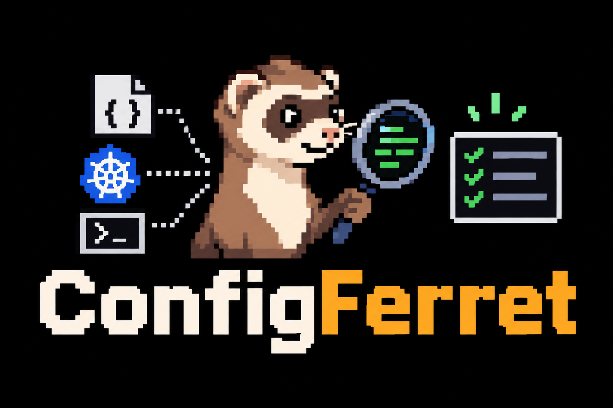

<p align="center">
  
</p>

# ConfigFerret

**Why is this value 42?** ConfigFerret traces every effective .NET configuration value back through all the
layers that set it: appsettings files, environment variables, the command line, Kubernetes ConfigMaps and
Secrets, Helm values files and Kustomize overlays.

```
Db:Timeout = "42"
  set in appsettings.json, overridden by appsettings.Production.json, overridden again by environment variable DB__Timeout from ConfigMap api-config, rendered by Helm template templates/configmap.yaml from .Values.db.timeout, set in values-prod.yaml over values.yaml (chart default)
  [overridden] appsettings.json (line 4) = "30"
  [overridden] appsettings.Production.json (line 3) = "60"
  [effective]  environment variable DB__Timeout = "42"
    <- [effective]  ConfigMap api-config (key DB__Timeout, rendered.yaml:7) = "42"
                    envFrom on Deployment/api, container api
      <- [effective]  Helm template templates/configmap.yaml (line 6) = "42" [inferred]
                      renders .Values.db.timeout
        <- [overridden] values.yaml (chart default) (line 3, db.timeout) = "30"
        <- [effective]  values-prod.yaml (line 2, db.timeout) = "42"
```

Each layer has its own partial debug view (`GetDebugView()`, `helm get values`, `kubectl describe`).
ConfigFerret joins them into one history per key.

## Install

```
dotnet package add ConfigFerret
```

Targets `net10.0` and `net11.0`.

Two optional packages read variables from deployment tools over their REST APIs. They are separate so the core
package stays offline and never handles credentials unless you add one:

| Package | Adds |
| --- | --- |
| `ConfigFerret.GitHub` | GitHub Actions organization, repository and environment variables, and secret names ([readme](src/ConfigFerret.GitHub/README.md)) |
| `ConfigFerret.Octopus` | Octopus Deploy project and library variable set variables, matched by scope, read with an API key ([readme](src/ConfigFerret.Octopus/README.md)) |

## Use

### Just .NET configuration

```csharp
using ConfigFerret;

var builder = WebApplication.CreateBuilder(args);
Console.WriteLine(builder.Configuration.Explain("Db:Timeout"));

// Or every setting, as text or JSON:
var report = builder.Configuration.TraceProvenance();
Console.WriteLine(report.ToText());
File.WriteAllText("config-provenance.json", report.ToJson());
```

### With Kubernetes, Helm and Kustomize

```csharp
using ConfigFerret;
using ConfigFerret.Helm;
using ConfigFerret.Kubernetes;
using ConfigFerret.Kustomize;

var report = ConfigTracer.For(builder.Configuration)
    // Rendered manifests: `helm template`, `kustomize build` or `kubectl get deploy/api -o yaml` plus its ConfigMaps.
    .WithKubernetes(KubernetesManifests.LoadFiles("rendered.yaml"), workload: "api", container: "api")
    // The chart and the values passed to helm install/upgrade, in the same order.
    .WithHelm(HelmChart.Load("charts/api", valuesFiles: ["values-prod.yaml"], setValues: ["db.timeout=42"]))
    // Or the overlay you deploy with kustomize.
    .WithKustomize(Kustomization.Load("deploy/overlays/prod"))
    .Trace();

Console.WriteLine(report.Explain("Db:Timeout"));
```

### With GitHub Actions or Octopus Deploy variables

```csharp
using ConfigFerret;
using ConfigFerret.GitHub;   // dotnet package add ConfigFerret.GitHub
using ConfigFerret.Octopus;  // dotnet package add ConfigFerret.Octopus

var github = await GitHubVariables.LoadAsync(new GitHubVariablesOptions
{
    Owner = "contoso", Repository = "api", Environment = "production",
    Token = Environment.GetEnvironmentVariable("GITHUB_TOKEN"),
});
var octopus = await OctopusVariables.LoadAsync(new OctopusVariablesOptions
{
    ServerUri = new Uri("https://contoso.octopus.app/"),
    ApiKey = Environment.GetEnvironmentVariable("OCTOPUS_API_KEY")!,
    Project = "api",
});

var report = ConfigTracer.For(builder.Configuration)
    .WithGitHub(github, o => o.AddWorkflow(".github/workflows/deploy.yml"))
    .WithOctopus(octopus, o => o.Environment = "Production")
    .Trace();
```

Tokens and API keys go only in request headers, only over HTTPS, and never into a report. Secret values cannot be read
from either API, so secrets and sensitive variables appear by name and are redacted like any other secret.

### Inside a running pod

```csharp
if (KubernetesInCluster.IsInCluster)
{
    var pod = await KubernetesInCluster.LoadCurrentPodAsync();
    var report = ConfigTracer.For(builder.Configuration).WithKubernetes(pod).Trace();
}
```

This reads the pod (`POD_NAME` or `HOSTNAME`) and the ConfigMaps it references with the pod's service account.
Grant it `get` on `pods` and `configmaps` in its namespace. Secrets are never read through the API.

## What it traces

| Layer | What ConfigFerret shows |
| --- | --- |
| JSON files (`appsettings*.json`) | File and line number |
| User secrets | Marked sensitive |
| Environment variables | The exact variable name, including prefixes and `__`, and `*CONNSTR_` connection strings |
| Command line | The argument |
| Key-per-file (mounted secrets) | The file, marked sensitive |
| Kubernetes `env` | Literal value, `configMapKeyRef`, `secretKeyRef`, `fieldRef`, with workload and container |
| Kubernetes `envFrom` | Which ConfigMap or Secret, with prefix, and the precedence between `envFrom` and `env` |
| Kubernetes volumes | Which ConfigMap or Secret key a mounted file comes from (`configMap`, `secret`, `projected`, `subPath`, `items`) |
| Helm | The template line that renders the key, and every values file and `--set` that set or removed the value |
| Kustomize | Every `configMapGenerator` and `secretGenerator` across bases and overlays (`create`, `merge`, `replace`, `literals`, `envs`, `files`, `namePrefix`, `nameSuffix`, hash suffixes) |
| GitHub Actions (`ConfigFerret.GitHub`) | The organization, repository or environment variable or secret, from a workflow `env:` line, an explicit link or the same name |
| Octopus Deploy (`ConfigFerret.Octopus`) | The project or library variable set variable whose scope fits the deployment, ordered by scope specificity |

Workloads: Deployment, StatefulSet, DaemonSet, ReplicaSet, Job, CronJob, Pod and `List` documents.

## Secrets

Values are redacted as `***` when they come from a Secret, user secrets, key-per-file or a `*CONNSTR_` environment
variable, or when the key looks secret (`password`, `pass`, `token`, `apikey`, `key`, `signingkey`, `connectionstring`, `sas`, `dsn` and so on). Turn this off
only on your own machine:

```csharp
ConfigTracer.For(config).WithOptions(o => o.RevealSensitiveValues = true);
```

## Limits

- Helm links are found by scanning templates for `.Values.x.y` on lines that set an env `value:` or a data key,
  so they are marked `[inferred]`. Values used through `with`, `range`, `include` or helpers are not linked yet.
  Subchart values are not traced yet.
- Kustomize patches that edit env entries or ConfigMap data are not traced yet.
- Like kustomize, a generator's `envs` files must be in or below the folder of the kustomization that names them.
  Pass `allowFilesOutsideFolder: true` to `Kustomization.Load` to lift this, like `--load-restrictor LoadRestrictionsNone`.
- GitHub and Octopus links by name or JSON key are guesses, so they are marked `[inferred]`; a workflow `env:` line or
  `Map` makes a certain link. When a name is on both an environment variable and the Kubernetes env entry behind it,
  the GitHub or Octopus layer shows under both. Octopus `#{...}` references are not expanded.
- YAML whose aliases expand to more than 10 million characters is rejected.
- Custom configuration providers show their `ToString()`. Add an `IOriginResolver` with `WithResolver` to trace
  further upstream from them.

## Build

```
dotnet build
dotnet test
dotnet pack src/ConfigFerret -c Release
dotnet pack src/ConfigFerret.GitHub -c Release
dotnet pack src/ConfigFerret.Octopus -c Release
```

Building `net11.0` needs the .NET 11 SDK. With only the .NET 10 SDK, pass `-p:TargetFrameworks=net10.0`.

`GoldenTests` traces three realistic setups in `tests/ConfigFerret.Tests/TestData/golden/` (a Helm release, a
Kustomize overlay and a developer machine) and compares the full text and JSON output with the approved snapshots
in `tests/ConfigFerret.Tests/Snapshots/`, using [Verify](https://github.com/VerifyTests/Verify). When you change
the output on purpose, the failing test writes a `.received.` file next to the snapshot: check the diff, then
rename it to `.verified.` (or accept it in your diff tool) and commit it.

CI builds and tests both on Linux for pull requests, and on Windows, Linux and macOS after a merge to `main`, then packs the three NuGet packages, all with the same version. Pushing a `v*` tag publishes
them to nuget.org with [trusted publishing](https://learn.microsoft.com/nuget/nuget-org/trusted-publishing), so no API key
is stored. It needs a trusted publishing policy on nuget.org for workflow `ci.yml` in this repository, owned by
the nuget.org account `Moonwalker1307` (set the `NUGET_USER` repository variable to use another account).

### Mutation testing

[Stryker.NET](https://stryker-mutator.io/docs/stryker-net/introduction/) checks how many code changes the tests
catch. It runs on `net10.0`, and needs the `TargetFrameworks` variable so the build skips `net11.0`:

```
dotnet tool restore
cd tests/ConfigFerret.Tests
TargetFrameworks=net10.0 dotnet stryker
```

The HTML report is written to `tests/ConfigFerret.Tests/StrykerOutput/<run>/reports/`.

The parsers are fuzzed every night on Linux with SharpFuzz and libFuzzer. See [fuzz/README.md](fuzz/README.md).

## License

MIT
