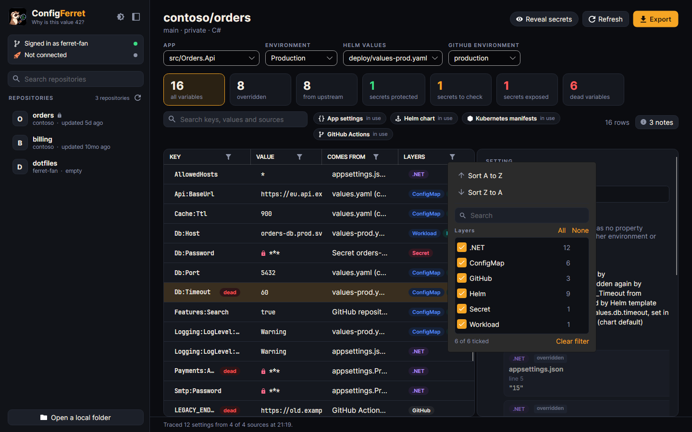

# ConfigFerret Desktop

A desktop app that shows where every configuration value in a repository comes from.


Sign in to GitHub with a token and the app lists the repositories the token can read. Click one and the app downloads
it and scans it for `appsettings` files, Helm charts, Kustomize overlays, Kubernetes manifests and workflows. It links
GitHub Actions variables and Octopus Deploy variables to what it finds, then shows everything on one page, in one table:

- every setting, with the source of its value and the layers it went through
- GitHub Actions and Octopus Deploy variables that no setting picks up, as rows of their own. A GitHub variable or
  secret a workflow uses directly, such as a publish profile passed to a deploy action, is tagged `workflow` with the
  file and line that uses it
- dead variables, marked in red: settings no code reads, Helm values no template reads, GitHub variables no
  setting or workflow uses, and Octopus variables no setting uses
- a secrets audit: green means the value is kept in a secret store, orange means check it, red means a secret value
  sits in plain configuration. A Secret manifest, or a Kustomize `secretGenerator` when the overlay is built, that
  holds the value in plain text or base64 is red, like a ConfigMap; a value encrypted with SOPS is not. A Secret value
  that a rendered Helm chart sets without its values files is orange, because the template may write it or generate it

### Filters

The stat tiles above the table are the filters: click **overridden**, **from upstream**, **secrets protected**,
**secrets to check**, **secrets exposed**, **dead variables**, **used by workflows** or **duplicated names** to show only those rows, and
click it again (or **all variables**) to show everything. **Duplicated names** shows names set in more than one row, such as a secret set for the repository and for an
environment, or `Db:Host` and `DB__HOST` (`:` and `__` count as the same, case is ignored). The search box looks in keys, values, sources and variable
names, so `ELWIZ_DB` finds a GitHub secret whether it is a row of its own or a layer of a setting.

Each column header has a filter button, like a spreadsheet: sort A to Z or Z to A, search the column, and tick the
values to show (sections for KEY, sources for COMES FROM, layer kinds for LAYERS). **Show all** clears every filter.



The **Sources** drop-down next to the search lists what the scan found in the repository (Helm chart, Kustomize,
Kubernetes manifests, GitHub Actions, Octopus Deploy). Untick one to trace again without it; the choice is kept per
repository. App settings are the starting point of a trace and stay on. The notes button lists warnings, source
problems and what the dead-variable scan read. When the repository holds a Helm chart or overlay for each of several
apps, the one named most like the app picked is traced, with a values file from the chart's own folder first, and the
notes name the chart. An overlay named for the environment comes first, even when only the bases are named like the
apps.

A workflow `env:` entry such as `Db__Host: ${{ vars.DB_HOST }}` counts as an environment variable of the app, so
`Db:Host` gets the variable's value and links back to it. Only entries that look like app settings are used: names with
`__`, connection strings, or names of keys in `appsettings`. Kubernetes manifests and environment variable sources win
over workflow entries. GitHub doesn't return secret values, so a setting a workflow takes from a secret shows
`(GitHub secret)`. In the same way a variable whose value the manifests don't hold, such as one from a Secret outside
the repository, shows `(value not in the manifests)` and links to the Secret, ConfigMap or field it comes from.

You can also open a local folder instead of a GitHub repository. Hide the repository sidebar with the button at its top,
or Ctrl+B (Cmd+B on macOS), to give the results the whole window.


### How dead settings are found

The app reads the C# code in the app's folder and in the projects it references (test projects, `bin` and `obj` are
skipped) and collects the keys it reads: `config["A:B"]`, `GetValue<T>("A:B")`, `GetSection("A")`,
`GetConnectionString("Db")`, `Environment.GetEnvironmentVariable("A__B")`, and sections, or the whole configuration,
bound to an options class with `Configure<T>`, `Bind`, `Get<T>` or `BindConfiguration`. For a bound section only keys
that match a property of the class count as read, so `Db:Timeout` is dead when `DbOptions` has no `Timeout`, unless a
section below it is read or bound on its own, or the scan can't see every property the class has. That is the case
when the class derives from a class that isn't in the code or is more than 16 levels up, from one with its own name
(`Settings : Lib.Settings`), or from two different classes in classes of one name, and when the scan can't take its
declaration apart. A base named like an interface, `I` then a capital and a lower-case letter as in `IDisposable`,
adds no property, so `IISServerOptions` counts as a class. A `Bind` that names no class, such as
`config.Bind("Smtp", smtp)` or `config.Bind(settings)`, reads its section or the whole configuration. A key more than
64 segments below a bound section, or under more than 64 bound sections, counts as read. Keys the host reads itself,
such as `Logging`, `AllowedHosts` and variables that start with `ASPNETCORE_` or `DOTNET_`, always count as read, and
commented-out code doesn't.

The scan reads source text, so it can't follow a key built at run time, such as `config[name]`. Those places are
listed under the scan, and a dead setting may still be read there. So is a file the scan gave up on because reading it
took too long. A class whose declaration or one of whose properties the scan can't take apart, or whose bases go more
than 16 levels up, counts as having any property. Check other environments and apps before deleting.

## Download

Get the build for your system from the
[Releases page](https://github.com/Moonwalker1307/ConfigFerret/releases). Desktop releases are the ones tagged
`desktop-v*`. The app is released only on GitHub Releases, not on NuGet. The libraries are released separately on NuGet.

The builds are not signed:

- macOS: right-click `ConfigFerret.app` and choose Open, or run `xattr -dr com.apple.quarantine ConfigFerret.app`.
- Windows: if SmartScreen blocks it, choose More info, then Run anyway.
- Linux: extract the archive and run `./ConfigFerret.Desktop`.

## Credentials

Tokens and API keys are stored in the system credential store:

- Windows: Credential Manager
- macOS: Keychain
- Linux: Secret Service, through `secret-tool`

Or the app reads them from an environment variable, such as `GITHUB_TOKEN` or `OCTOPUS_API_KEY`.

A credential in an environment variable is used only when none is saved. They are never written to the app's own settings file, `ConfigFerret/workspace.json` in your user application data
folder.

## Token scopes

- GitHub classic token: `repo`.
- GitHub fine-grained token: Contents read, Metadata read, Variables read, Secrets read, Environments read.
- Octopus Deploy: an API key for a user who can view projects and variables.

## Optional tools

If `helm` and `kubectl` or `kustomize` are on your `PATH`, the app renders charts and overlays, so the values link
back to the app's settings. Without them the app reads the files as they are. Only the `PATH` folders are searched,
not the current folder or the app's own folder, and on Windows only for `.exe` files. When a tool is installed but
fails, the notes name the tool and its exit code, and the reason for a few common errors, such as chart dependencies
that are not committed. Its own error output is not shown, because it can quote values; run the tool on the folder to
see it.

helm reads what a symbolic link in the chart folder leads to, so the app does not run helm for a chart with a link
that leads out of the repository, and the notes name the link. Links that stay inside the repository are fine.

## Release

Push a tag named `desktop-vX.Y.Z` (or `desktop-vX.Y.Z-pre` for a prerelease). The
`.github/workflows/desktop-release.yml` workflow builds every platform and creates the GitHub release. It does not
touch NuGet.

## Build and run

```
dotnet run --project src/ConfigFerret.Desktop -f net10.0
```
