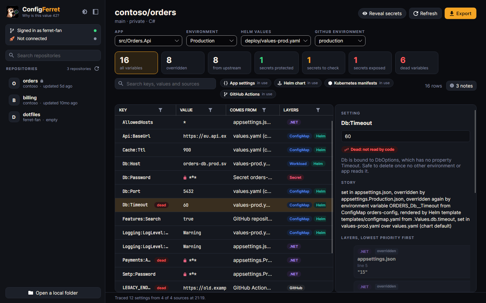
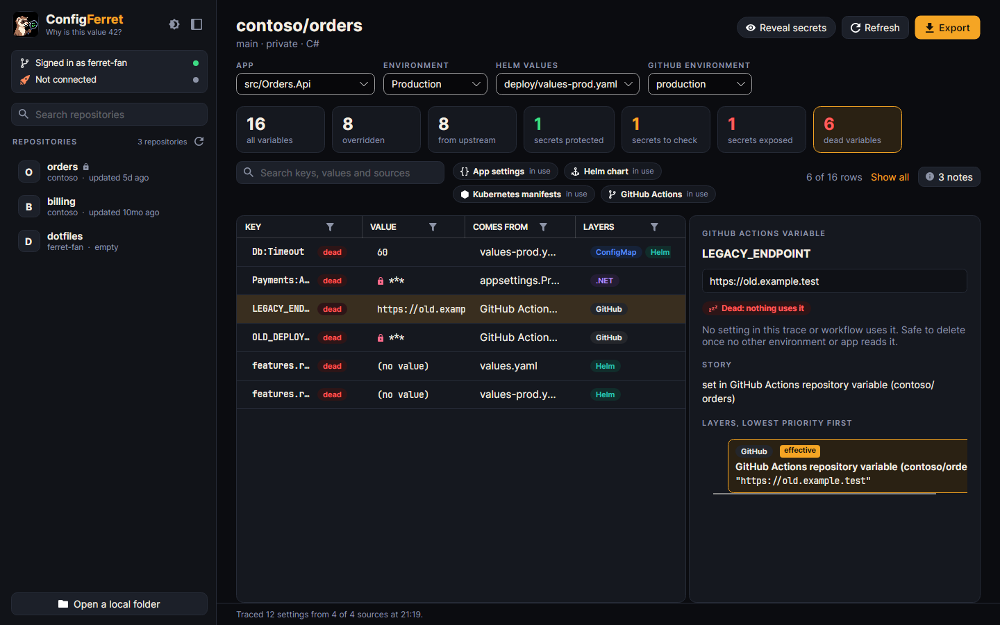

# ConfigFerret Desktop

A desktop app that shows where every configuration value in a repository comes from.



Sign in to GitHub with a token and the app lists the repositories the token can read. Click one and the app downloads
it and scans it for `appsettings` files, Helm charts, Kustomize overlays, Kubernetes manifests and workflows. It links
GitHub Actions variables and Octopus Deploy variables to what it finds, then shows everything on one page, in one table:

- every setting, with the source of its value and the layers it went through
- GitHub Actions and Octopus Deploy variables that no setting picks up, as rows of their own. A GitHub variable or
  secret a workflow uses directly, such as a publish profile passed to a deploy action, is tagged `workflow` with the
  file and line that uses it
- dead variables, marked in red: settings no code reads, Helm values no template reads, GitHub variables no
  setting or workflow uses, and Octopus variables no setting uses
- a secrets audit: green means the value is kept in a secret store, orange means check it, red means a secret value
  sits in plain configuration

### Filters

The stat tiles above the table are the filters: click **overridden**, **from upstream**, **secrets protected**,
**secrets to check**, **secrets exposed**, **dead variables** or **used by workflows** to show only those rows, and
click it again (or **all variables**) to show everything. The search box looks in keys, values, sources and variable
names, so `ELWIZ_DB` finds a GitHub secret whether it is a row of its own or a layer of a setting.

Each column header has a filter button, like a spreadsheet: sort A to Z or Z to A, search the column, and tick the
values to show (sections for KEY, sources for COMES FROM, layer kinds for LAYERS). **Show all** clears every filter.


The chips next to the search show what the scan found in the repository, and the notes button lists warnings, source
problems and what the dead-variable scan read.

A workflow `env:` entry such as `Db__Host: ${{ vars.DB_HOST }}` counts as an environment variable of the app, so
`Db:Host` gets the variable's value and links back to it. Only entries that look like app settings are used: names with
`__`, connection strings, or names of keys in `appsettings`. Kubernetes manifests and environment variable sources win
over workflow entries. GitHub doesn't return secret values, so a setting a workflow takes from a secret shows
`(GitHub secret)`.

You can also open a local folder instead of a GitHub repository. Hide the repository sidebar with the button at its top,
or Ctrl+B (Cmd+B on macOS), to give the results the whole window.



### How dead settings are found

The app reads the C# code in the app's folder and in the projects it references (test projects, `bin` and `obj` are
skipped) and collects the keys it reads: `config["A:B"]`, `GetValue<T>("A:B")`, `GetSection("A")`,
`GetConnectionString("Db")`, and sections bound to an options class with `Configure<T>`, `Bind`, `Get<T>` or
`BindConfiguration`. For a bound section only keys that match a property of the class count as read, so `Db:Timeout`
is dead when `DbOptions` has no `Timeout`. Keys the host reads itself, such as `Logging` and `AllowedHosts`, always
count as read, and commented-out code doesn't.

The scan reads source text, so it can't follow a key built at run time, such as `config[name]`. Those places are
listed under the scan, and a dead setting may still be read there. Check other environments and apps before deleting.

## Download

Get the build for your system from the
[Releases page](https://github.com/Moonwalker1307/ConfigFerret/releases). Desktop releases are the ones tagged
`desktop-v*`. The app is released only on GitHub Releases, not on NuGet. The libraries are released separately on NuGet.

The builds are not signed:

- macOS: right-click `ConfigFerret.app` and choose Open, or run `xattr -dr com.apple.quarantine ConfigFerret.app`.
- Windows: if SmartScreen blocks it, choose More info, then Run anyway.
- Linux: extract the archive and run `./ConfigFerret.Desktop`.

## Credentials

Tokens and API keys are stored in the system credential store:

- Windows: Credential Manager
- macOS: Keychain
- Linux: Secret Service, through `secret-tool`

Or the app reads them from an environment variable, such as `GITHUB_TOKEN` or `OCTOPUS_API_KEY`.

A credential in an environment variable is used only when none is saved. They are never written to the app's own settings file, `ConfigFerret/workspace.json` in your user application data
folder.

## Token scopes

- GitHub classic token: `repo`.
- GitHub fine-grained token: Contents read, Metadata read, Variables read, Secrets read, Environments read.
- Octopus Deploy: an API key for a user who can view projects and variables.

## Optional tools

If `helm` and `kubectl` or `kustomize` are on your `PATH`, the app renders charts and overlays, so the values link
back to the app's settings. Without them the app reads the files as they are.

## Release

Push a tag named `desktop-vX.Y.Z` (or `desktop-vX.Y.Z-pre` for a prerelease). The
`.github/workflows/desktop-release.yml` workflow builds every platform and creates the GitHub release. It does not
touch NuGet.

## Build and run

```
dotnet run --project src/ConfigFerret.Desktop -f net10.0
```
