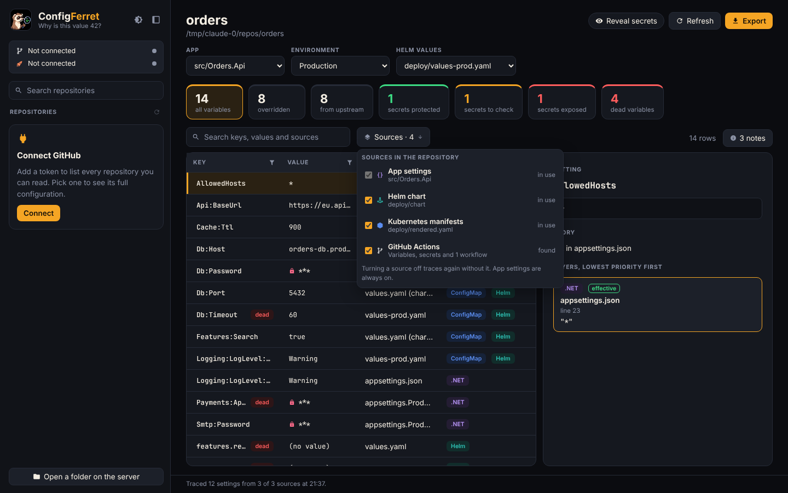
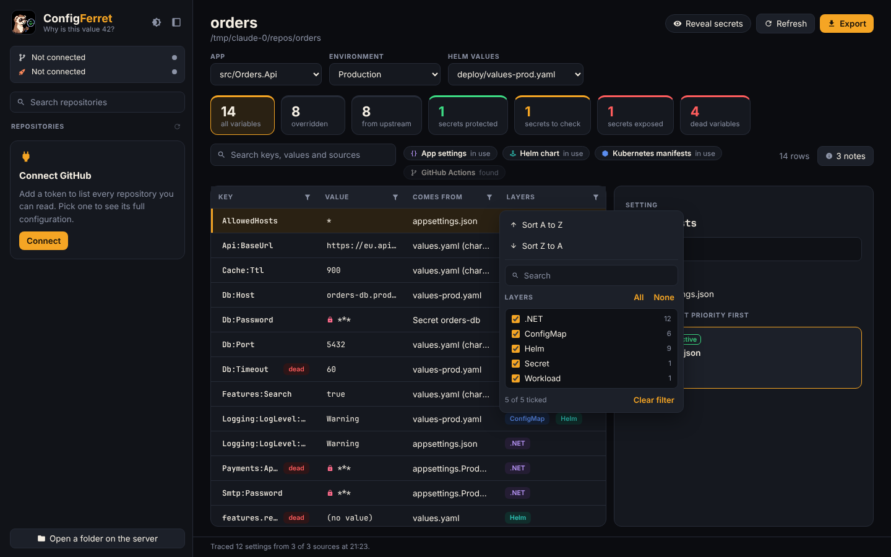

# ConfigFerret Web

The [desktop app](../ConfigFerret.Desktop/README.md) as a website that runs in a Docker container. It has the same
screen: the repositories your GitHub token can read, and for the one you pick, one table with every setting and the
history of its value, GitHub and Octopus variables no setting picks up, dead variables and the secrets audit. The stat
tiles filter the table, and each column header has a sort, search and tick-list filter.





## Run

```
docker run --rm -p 127.0.0.1:8080:8080 ghcr.io/moonwalker1307/configferret-web
```

Open http://localhost:8080, click Connect and paste a GitHub token. Add an Octopus Deploy server and API key if you
deploy with Octopus.

To keep your settings and open repositories that are already cloned on your machine:

```
docker run -d --name configferret -p 127.0.0.1:8080:8080 \
  -v configferret-data:/data \
  -v ~/src:/repos:ro \
  ghcr.io/moonwalker1307/configferret-web
```

| Path in the container | What it is |
| --- | --- |
| `/data` | The workspace file (connection addresses, theme and the choices made per repository) and the keys that protect the page's session state. Never a token. |
| `/repos` | Folders you can open with "Open a folder on the server". Only folders under it can be opened, and links are not followed. Mount it read-only. Without it, the button is hidden. |

Or with Docker Compose:

```yaml
services:
  configferret:
    image: ghcr.io/moonwalker1307/configferret-web
    ports: ["127.0.0.1:8080:8080"]
    volumes:
      - configferret-data:/data
      - ~/src:/repos:ro
volumes:
  configferret-data:
```

The image runs as a non-root user, has no shell, and listens on port 8080. It includes `helm` and `kubectl`, so Helm
charts and Kustomize overlays are rendered, without network access, like the desktop app does when they're installed.
The tools get only the environment variables they need to run (`PATH`, the home and temp folders, and Helm's folder
settings), never the tokens below.

## Credentials

A token or API key you type in stays in the server's memory for that browser tab only. It is never written to disk,
and other tabs and other people using the server can't see it. Reloading the page asks for it again.

To skip typing it, give the container a token instead: `-e GITHUB_TOKEN=...`, and for Octopus
`-e OCTOPUS_URL=https://... -e OCTOPUS_API_KEY=...`. A typed-in token wins over these.

**The app has no sign-in of its own.** A token in the container's environment is used by everyone who can open the
page. Publish the port on `127.0.0.1` only, as above, or put the app behind a reverse proxy that signs people in (such
as oauth2-proxy) before you open it to others.

The app answers only requests addressed to `localhost`, `127.0.0.1` or `[::1]`, on any port, and refuses other host
names with 400 Bad Request. This stops a web page that re-points its own name at your machine (DNS rebinding) from
using the app as if you had opened it. Earlier versions answered any name. **If you reach the app by another name,
such as a reverse proxy's address, a machine name or an IP address, set `AllowedHosts` to that name**, for example
`-e AllowedHosts=ferret.example.com`. It is the host name in the requests the app receives: the one people type in the
browser, or the upstream name if your proxy rewrites the `Host` header. Separate several names with `;`;
`*.example.com` allows its subdomains and `*` allows any name. The value replaces the default list, so add
`localhost` to it (`-e "AllowedHosts=ferret.example.com;localhost"`) if you also open the app on this machine.
`/healthz` answers any name and says only `ok`, so health probes that use the container's IP address keep working.

The token scopes are the desktop app's: a classic token with `repo`, or a fine-grained token with Contents, Metadata,
Variables, Secrets and Environments read.

## Settings

Set these as environment variables on the container.

| Variable | Default in the image | |
| --- | --- | --- |
| `ConfigFerret__DataFolder` | `/data` | Where the workspace file and keys are saved. |
| `ConfigFerret__Folders` | `/repos` | The folder whose subfolders can be opened. Empty turns it off. |
| `ASPNETCORE_HTTP_PORTS` | `8080` | The port the app listens on. |
| `AllowedHosts` | `localhost;127.0.0.1;[::1]` | The host names the app answers, separated by `;`. `*` allows any. |
| `GITHUB_TOKEN`, `GH_TOKEN` | | A GitHub token used when none is typed in. |
| `OCTOPUS_URL`, `OCTOPUS_API_KEY` | | An Octopus server and API key used when none is typed in. |

The workspace file is shared by everyone using the server, so the theme and the choices per repository are too.

## Build the image

From the repository root:

```
docker build -f src/ConfigFerret.Web/Dockerfile -t configferret-web .
```

Pass `--build-arg INSTALL_TOOLS=false` to leave out `helm` and `kubectl`, or `HELM_VERSION` and `KUBECTL_VERSION` to
pick other versions. The build stages cross-compile, so `--platform linux/arm64` builds without emulation.

## Run from source

```
dotnet run --project src/ConfigFerret.Web -f net10.0
```

It opens on http://localhost:5080. Set `ConfigFerret__Folders` to a folder of clones to try "Open a folder".

## How it is built

The web app has no scanning or tracing code of its own. It compiles the desktop app's model, services, view models
and credential stores as shared source, and draws the desktop app's `MainWindowViewModel` with Blazor (interactive
server rendering). A change to how the desktop app analyses a repository shows up in both. Only the views differ:
`Components/` here, `Views/` in the desktop app.

Each browser tab gets its own view model on the server, with its own credentials and its own temporary folder for
downloaded repositories, which is deleted when the tab closes.

## Release

Push a tag named `web-vX.Y.Z` (or `web-vX.Y.Z-pre` for a prerelease). The `.github/workflows/web-release.yml`
workflow builds the image for linux/amd64 and linux/arm64, pushes it to `ghcr.io/moonwalker1307/configferret-web`
with the version as its tag (and `latest`, for a release that isn't a prerelease), and creates a GitHub release. It
does not touch NuGet.

The first push creates the package on GitHub as private. To let people pull it without signing in, make it public
under the package's settings on GitHub.
